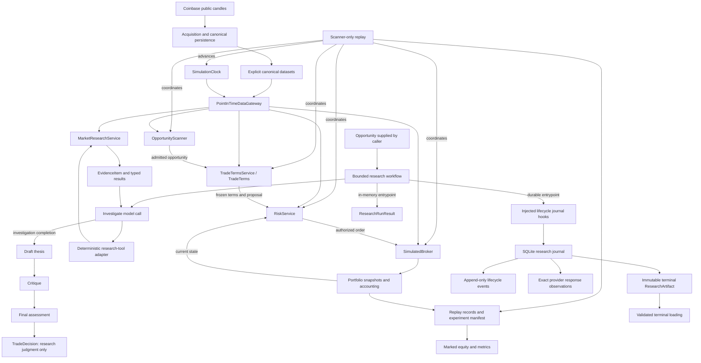

# Current architecture

Crypteo is a Python modular monolith under `src/crypteo/`. It implements a
research platform with canonical market data, controlled historical visibility,
deterministic opportunity discovery and evidence, bounded model-backed research,
and separate simulated trade terms, risk, execution, accounting, and scanner-only
replay. The [README](../README.md) describes the product; the
[V1 specification](v1-specification.md) defines exact behavioral semantics.

## Component flow

Arrows show current data/control relationships. Model-backed research is a
separate caller-invoked API; scanner-only replay invokes neither research tools
nor the model workflow.

The opportunity-to-terms-to-risk arrows represent replay's coordination. Services
do not call one another or share an autonomous agent loop. Research assembly uses
its supplied runtime clock and datasets to construct its own gateway and matching
source bindings; it does not attach itself to an existing replay run.

## Data and historical visibility

Coinbase retrieval, normalization, dataset composition, and local persistence
preserve raw observations, canonical semantic data, and acquisition provenance as
separate immutable artifacts. Publication verifies their association. Loading is
explicit by dataset version, with optional acquisition linkage; it does not fetch
or repair data. The [data pipeline](data-pipeline.md) owns storage formats, gaps,
containment, and failure/concurrency details.

`SimulationClock` owns historical time. Runtime alone advances it.
`PointInTimeDataGateway` validates input candles and exposes only completed,
available history at that time. Scanner, research, terms, risk, and broker consume
this boundary without supplying their own cutoff. Pure analytics operates on
supplied candles; it cannot grant visibility. Full-dataset acquisition and integrity
checks are distinct from historical decision-time reads.

## Discovery and evidence

`OpportunityScanner` applies the fixed Bollinger crossover policy to visible
history and returns a reproducible snapshot of candidates. An `Opportunity` is
research context; it does not grant trading authority. Replay owns freshness,
delivery, and deduplication.

`MarketResearchService` supplies seven fixed-window tools: trend, momentum,
volatility, Bollinger position, recent levels, volume context, and relative
strength. Each returns typed unavailable information or neutral measurements in
a common `EvidenceItem`, with temporal and source provenance. Evidence identity
describes contributing data and computed payload; acquisition and whole-dataset
identities remain provenance. Large candle windows stay outside the envelope.

Common opportunity, evidence, thesis, critique, and assessment schemas are validated
contracts. They revalidate existing/nested instances and detach mutable inputs.
The model-backed workflow produces validated theses, critiques, and assessments
through those common contracts.

## Model-backed research

`run_opportunity_research` compiles a five-node typed LangGraph workflow:
`investigate --tool request--> execute_tool --result--> investigate`;
only investigation completion advances through
`investigate --complete--> draft_thesis → critique → final_assessment`.
The investigator chooses among seven deterministic market capabilities; the tool
adapter binds the opportunity's subject and allows only a relative-strength
benchmark argument. Software enforces tool-attempt, invalid-request, model-call,
output, provider-input, and deadline budgets. The graph recursion limit is a
secondary guard. Exact limits live in the
[specification](v1-specification.md#bounded-model-backed-research).

`ResearchModel` is the project-owned async provider abstraction: it prepares the
provider-facing request and returns typed replies and observable metadata.
`OpenAIResearchModel` currently implements it with the OpenAI Responses API,
strict structured schemas, no automatic retries, and no provider conversation
state. The caller owns client lifetime and chooses the model and supported
parameters. Prompts, schemas, and tool definitions carry versions and digests.
Its observable invocation boundary exposes client-visible HTTP entity bytes
before project decoding; durable hooks persist those observations separately
from normalized project-owned replies.

The runtime captures one research time from the executing `MarketResearchService`
and requires the opportunity's observation time to match it. The service binds
all reads to its authoritative gateway; models cannot choose cutoffs or windows.
Clock checks surround model/tool/cache boundaries and return. Successful evidence
is deduplicated consistently, and research references must resolve within the run.
The critic receives a fresh context containing the validated thesis, all collected
evidence, and request history; completed research cannot skip it. This is
procedural independence, not statistical independence.

A completed run contains a model assessment. An operational interruption contains
a typed failure and deterministic runtime `ABSTAIN`; it is not a completed model
conclusion. Neither result calls `TradeTermsService`, `RiskService`,
`SimulatedBroker`, or portfolio/accounting. `TRADE` supports further consideration
of a LONG setup and grants no financial authority. Mapping that judgment into a
trade proposal and historical model-backed replay remain future integration work.
[ADR-009](decisions/ADR-009-bounded-model-directed-research.md) records this boundary.

`ResearchRunResult` retains in-memory context, configuration, code/provider/graph
identity, exact observable model requests/replies, provider metadata, tool attempts
and cache/rejection links, research stages, and transitions/termination. Retained
relationships are validated so trace, evidence, and context cannot be arbitrarily
recombined. The in-memory entrypoint remains usable without a store. Exact
fresh-inference reproducibility is not promised.

## Durable research lifecycle

`run_durable_opportunity_research(..., store=...)` registers a caller-supplied run
ID and injects a `ResearchJournal` into the same workflow runtime. Runtime hooks
emit lifecycle records; SQLite persistence is not embedded in graph nodes.
`ResearchStore` owns local transactions using standard-library SQLite, separately
from Coinbase acquisition/canonical persistence and scanner-only replay.

The three layers have distinct responsibilities:

- Active in-memory graph state holds the current context, evidence, trace, and
  stage outputs used to advance bounded research.
- The durable journal retains the authoritative append-only committed lifecycle:
  prepared requests, call starts, exact provider response BLOBs, normalized replies,
  tool requests/resolutions and cache links, validated stages, and transitions.
  A valid prefix without a terminal event is `INCOMPLETE`; inspection can expose
  unresolved boundaries without assuming a crash or manufacturing a conclusion.
- `ResearchArtifact` is an immutable terminal consumer projection containing a
  validated `ResearchRunResult` and journal integrity linkage. It is published
  atomically with `RUN_FINISHED` for `COMPLETED` or `INTERRUPTED` research. A
  best-effort `RUN_ABORTED` closes a run without an ordinary result/artifact.

Lifecycle commits precede dependent provider/tool actions and downstream use of
their results. No transaction spans SQLite and an external provider or tool
execution. Storage failure stops further work and raises without returning an
artifact; it never becomes `NO_TRADE` or ordinary runtime `ABSTAIN`. An uncertain
commit can leave retained data for later inspection. Terminal closure is permanent.

Consumers call `ResearchStore.load_terminal` to obtain validated `ResearchArtifact`
objects rather than consume SQL rows. `inspect_run` validates committed prefixes,
terminal consistency, and unresolved operations. Both validate retained
relationships without inference, market-data reads, or tool redispatch. Recovery
means SQLite transactional recovery and inspection/loading; automatic graph resume,
provider retry after crash, and stale-run takeover are unimplemented.

The model and journal layer grants no financial authority and does not connect
`TRADE` to terms, risk, execution, or portfolio mutation. Validated terminal loading
is the current consumer boundary; historical model-backed replay and baseline/model
comparison remain unimplemented. See the
[lifecycle specification](v1-specification.md#durable-research-lifecycle) and
[ADR-010](decisions/ADR-010-durable-research-lifecycle.md).

## Terms, authorization, and execution

`TradeTermsService` creates immutable market-derived stop/target terms from visible
history. It neither selects opportunities nor sizes positions. Replay freezes
terms before constructing the baseline proposal. `RiskService` checks that proposal
against the current portfolio and decision-time market reference, validates costs
and target economics, and sizes the largest permitted aligned quantity.
Authorization neither reserves cash nor changes portfolio state.

`SimulatedBroker` accepts already-authorized orders and reconciles next-open fills
only when the corresponding completed candle is visible. It owns one pending or
open trade at a time. Fees, adverse slippage, gaps, stop/target precedence, and time
exits are deterministic. Unknown next-open prices can cause affordability rejection
or losses beyond the decision-time estimate.

Portfolio transitions maintain exact cash, fee, cost-basis, and realized-P&L
accounting in immutable snapshots with append-only histories. Broker processing
commits a validated snapshot atomically. Missing entry data causes terminal
rejection; missing holding data preserves an unresolved position and halts finances.

## Replay and artifacts

`run_scanner_only` validates explicit canonical inputs and builds one clock/gateway
shared by scanner, terms, risk, and broker. At each decision boundary it reconciles
execution first, scans, admits fresh candidates in deterministic order, freezes
terms, selects every candidate with valid terms, and authorizes/submits sequentially.
It records a portfolio observation before advancing the clock. The final boundary
reconciles and observes without new decisions or forced liquidation.

`ReplayResult` retains the experiment manifest, ordered lifecycle records,
observations, final portfolio, and metrics. Canonical serialization supports
byte-stable reproduction. Validation reconciles retained execution/risk records
and ledger prefixes, and recomputes metrics. It does not reconstruct market paths
absent from the artifact. Marked equity uses visible completed closes; a holding
gap leaves only valid-prefix valuation and known realized results available.

These replay artifacts remain in-memory with canonical JSON output; the research
journal does not persist scanner-only replay. Replay lifecycle persistence, replay
resumption, historical model-backed replay (including frozen-response agentic
replay), and a walk-forward evaluation runner are unimplemented. Exact ordering,
end conditions, artifact identity, and metric semantics live in the
[replay specification](v1-specification.md#scanner-only-replay).

## Research extension boundary

Opportunity-led model research is implemented. Future trader-led interactive
research should converge on the same evidence, thesis, critique, and assessment
engine; deterministic tools already operate without requiring an `Opportunity`.
Research assessment stays separate from deterministic authorization.

Future research domains should emit normalized evidence. Sources require credible
historical availability to be replay safe; live-only sources cannot enter historical
evaluation. A bounded coordinator and relevant specialist capabilities are a
long-term direction, not current components or V1 orchestration. Recursive
delegation, unrestricted loops, and independently trading agents remain excluded.
Trader-led chat, live mode, UI, web/news/social/on-chain/derivatives research,
and long-term memory/RAG are unimplemented. Real order routing,
trading credentials, private keys, and withdrawal capabilities are out of scope.
