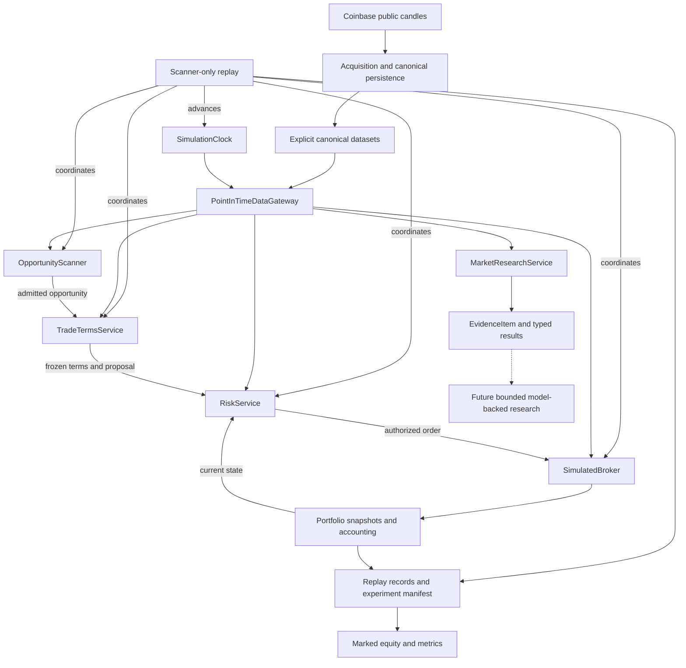

# Current architecture

Crypteo is a Python modular monolith under `src/crypteo/`. It implements a
simulation-only research substrate: canonical market data, controlled historical
visibility, deterministic opportunity discovery and evidence, trade terms, risk,
execution, accounting, and scanner-only replay. Model-backed research orchestration
is unimplemented. The [README](../README.md) describes the product; the
[V1 specification](v1-specification.md) defines exact behavioral semantics.

## Component flow

Solid arrows show current data/control relationships. The dashed connection marks
an unimplemented research consumer. Research tools are standalone and are not
invoked by scanner-only replay.

The opportunity-to-terms-to-risk arrows represent replay's coordination. Services
do not call one another or share an autonomous agent loop. Research assembly uses
its supplied runtime clock and datasets to construct its own gateway and matching
source bindings; it does not attach itself to an existing replay run.

## Data and historical visibility

Coinbase retrieval, normalization, dataset composition, and local persistence
preserve raw observations, canonical semantic data, and acquisition provenance as
separate immutable artifacts. Publication verifies their association. Loading is
explicit by dataset version, with optional acquisition linkage; it does not fetch
or repair data. The [data pipeline](data-pipeline.md) owns storage formats, gaps,
containment, and failure/concurrency details.

`SimulationClock` owns historical time. Runtime alone advances it.
`PointInTimeDataGateway` validates input candles and exposes only completed,
available history at that time. Scanner, research, terms, risk, and broker consume
this boundary without supplying their own cutoff. Pure analytics operates on
supplied candles; it cannot grant visibility. Full-dataset acquisition and integrity
checks are distinct from historical decision-time reads.

## Discovery and evidence

`OpportunityScanner` applies the fixed Bollinger crossover policy to visible
history and returns a reproducible snapshot of candidates. An `Opportunity` is
research context; it does not grant trading authority. Replay owns freshness,
delivery, and deduplication.

`MarketResearchService` supplies seven fixed-window tools: trend, momentum,
volatility, Bollinger position, recent levels, volume context, and relative
strength. Each returns typed unavailable information or neutral measurements in
a common `EvidenceItem`, with temporal and source provenance. Evidence identity
describes contributing data and computed payload; acquisition and whole-dataset
identities remain provenance. Large candle windows stay outside the envelope.

Common opportunity, evidence, thesis, critique, and assessment schemas are validated
contracts. They revalidate existing/nested instances and detach mutable inputs.
Thesis and assessment schemas exist without a model-backed producer.

## Terms, authorization, and execution

`TradeTermsService` creates immutable market-derived stop/target terms from visible
history. It neither selects opportunities nor sizes positions. Replay freezes
terms before constructing the baseline proposal. `RiskService` checks that proposal
against the current portfolio and decision-time market reference, validates costs
and target economics, and sizes the largest permitted aligned quantity.
Authorization neither reserves cash nor changes portfolio state.

`SimulatedBroker` accepts already-authorized orders and reconciles next-open fills
only when the corresponding completed candle is visible. It owns one pending or
open trade at a time. Fees, adverse slippage, gaps, stop/target precedence, and time
exits are deterministic. Unknown next-open prices can cause affordability rejection
or losses beyond the decision-time estimate.

Portfolio transitions maintain exact cash, fee, cost-basis, and realized-P&L
accounting in immutable snapshots with append-only histories. Broker processing
commits a validated snapshot atomically. Missing entry data causes terminal
rejection; missing holding data preserves an unresolved position and halts finances.

## Replay and artifacts

`run_scanner_only` validates explicit canonical inputs and builds one clock/gateway
shared by scanner, terms, risk, and broker. At each decision boundary it reconciles
execution first, scans, admits fresh candidates in deterministic order, freezes
terms, selects every candidate with valid terms, and authorizes/submits sequentially.
It records a portfolio observation before advancing the clock. The final boundary
reconciles and observes without new decisions or forced liquidation.

`ReplayResult` retains the experiment manifest, ordered lifecycle records,
observations, final portfolio, and metrics. Canonical serialization supports
byte-stable reproduction. Validation reconciles retained execution/risk records
and ledger prefixes, and recomputes metrics. It does not reconstruct market paths
absent from the artifact. Marked equity uses visible completed closes; a holding
gap leaves only valid-prefix valuation and known realized results available.

These are in-memory audit artifacts with canonical JSON output. Durable lifecycle
journaling, restart recovery, agentic replay, and a walk-forward evaluation runner
are unimplemented. Exact ordering, end conditions, artifact identity, and metric
semantics live in the [replay specification](v1-specification.md#scanner-only-replay).

## Research extension boundary

Future bounded orchestration can consume the existing evidence contracts to
investigate, draft a thesis, critique it, and produce `TRADE`, `NO_TRADE`, or
`ABSTAIN`. Research selection stays separate from deterministic authorization.
Trader-led questions and opportunity-led research should converge on that same
workflow; tools already operate without requiring an `Opportunity`.

Future research domains should emit normalized evidence. Sources require credible
historical availability to be replay safe; live-only sources cannot enter historical
evaluation. A bounded coordinator and relevant specialist capabilities are a
long-term direction, not current components or V1 orchestration. Recursive
delegation, unrestricted loops, and independently trading agents remain excluded.
Live mode, non-market research, and UI are unimplemented. Real order routing,
trading credentials, private keys, and withdrawal capabilities are out of scope.
